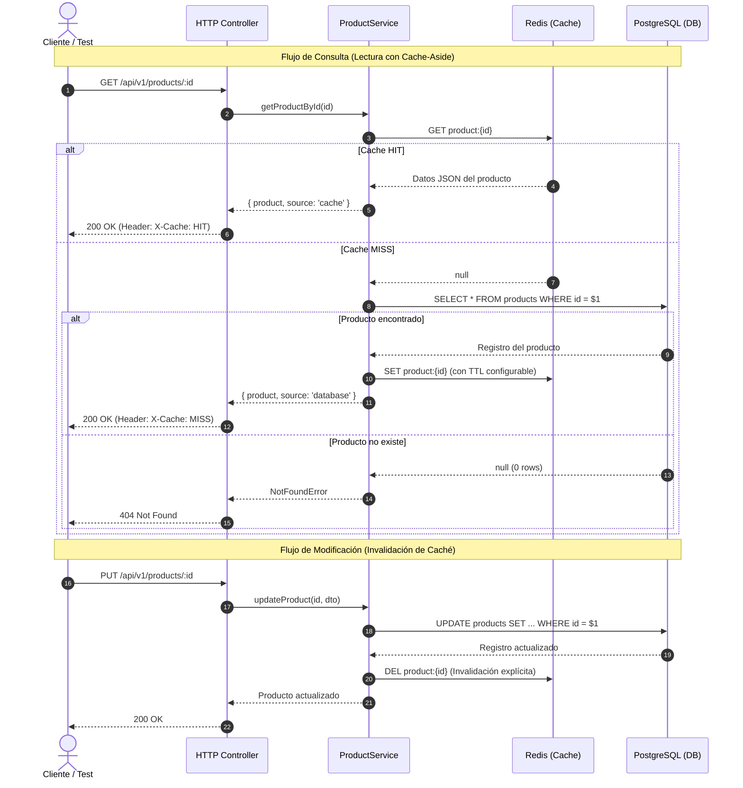

# Product Catalog API (PostgreSQL + Redis Cache + Testcontainers)

API de catálogo de productos construida en **TypeScript** con arquitectura limpia (Clean Architecture / Puertos y Adaptadores). Demuestra el funcionamiento integrado de **PostgreSQL** (persistencia relacional) y **Redis** (caché mediante el patrón *Cache-Aside* con TTL e invalidación).

La suite de pruebas de integración utiliza **Vitest** y **Testcontainers** (`@testcontainers/postgresql` y `@testcontainers/redis`), ejecutándose contra contenedores reales, desechables y con puertos asignados dinámicamente, sin utilizar mocks ni depender de servicios compartidos.

---

## 1. Arquitectura y Flujo PostgreSQL–Redis

La aplicación implementa el patrón canónico **Cache-Aside** (Lectura diferida) e **Invalidación reactiva** (en operaciones de escritura/actualización):



---

## 2. Requisitos Previos

- **Node.js**: v20.x o superior (LTS recomendado).
- **Docker Desktop**: En ejecución con soporte para contenedores Linux.
- **npm**: v10.x o superior.

---

## 3. Instalación

En la raíz del proyecto (`catalog-api`):

```bash
npm install
```

---

## 4. Ejecución de Pruebas de Integración con Testcontainers

Para ejecutar la suite completa de integración:

```bash
npm test
```

Para modo interactivo / observador:

```bash
npm run test:watch
```

### ¿Cómo garantiza Testcontainers el aislamiento?
1. **Contenedores desechables**: En `beforeAll()`, Testcontainers descarga e inicia dos contenedores independientes en Docker: `PostgreSqlContainer("postgres:16-alpine")` y `RedisContainer("redis:7-alpine")`.
2. **Cero puertos fijos**: Las cadenas de conexión se obtienen dinámicamente mediante `pgContainer.getConnectionUri()` y `redisContainer.getConnectionUrl()`. Nunca hay conflicto de puertos locales (`5432` o `6379`).
3. **Esquema automático**: Al inicializar la suite, se ejecuta el script `schema.sql` creando la tabla `products` e índices de forma idempotente.
4. **Limpieza entre pruebas**: Cada caso (`beforeEach`) ejecuta `TRUNCATE TABLE products RESTART IDENTITY CASCADE` y `redisClient.flushall()`, garantizando independencia del orden de ejecución y ausencia de datos residuales.
5. **Cierre limpio**: En `afterAll()`, los pools de conexión y clientes se cierran adecuadamente, y ambos contenedores de Docker son destruidos.

---

## 5. Pruebas Mínimas Implementadas

| Escenario | Comportamiento Verificado | Aserción Observable |
|---|---|---|
| **1. Crear producto** | Valida entrada, almacena en PostgreSQL e invalida caché. | Retorna HTTP 201 y consulta directa con `pg.Pool` confirma la fila física en la base de datos. |
| **2. Consulta con caché vacía** | Consulta PostgreSQL (Cache MISS) y almacena en Redis con TTL. | Header `X-Cache: MISS`, `redis.get()` contiene el JSON serializado y `redis.ttl()` es positivo. |
| **3. Consulta posterior (Hit)** | Retorna directamente desde Redis sin consultar la base de datos. | Header `X-Cache: HIT`, espía en `repository.findById` confirma 0 llamadas a PostgreSQL. |
| **4. Actualizar producto** | Actualiza PostgreSQL e invalida la entrada de Redis. | Comprobación directa en DB, `redis.get()` retorna null, y siguiente lectura devuelve datos actualizados (nunca datos obsoletos). |
| **5. Producto inexistente** | Manejo de identificador no encontrado. | Retorna HTTP 404 consistente y explícito; no contamina la caché de Redis. |
| **6. Repetibilidad** | Suite completa sin dependencia del orden. | Puede ejecutarse múltiples veces consecutivas con 100% de éxito. |

---

## 6. Estructura del Código

```
catalog-api/
├── src/
│   ├── domain/
│   │   ├── entities/
│   │   │   └── product.entity.ts         # Modelo de dominio y DTOs
│   │   └── ports/
│   │       ├── product-repository.port.ts # Contrato del repositorio
│   │       └── cache-adapter.port.ts      # Contrato del adaptador de caché
│   ├── infrastructure/
│   │   ├── database/
│   │   │   ├── schema.sql                 # DDL de la tabla products
│   │   │   └── postgres-product.repository.ts # Implementación PostgreSQL con pg
│   │   └── cache/
│   │       └── redis-cache.adapter.ts     # Implementación Redis con ioredis
│   ├── services/
│   │   ├── product.service.ts             # Lógica de negocio y Cache-Aside
│   │   └── errors/
│   │       └── not-found.error.ts         # Excepción personalizada
│   ├── http/
│   │   ├── app.ts                         # Factoría Express con inyección de dependencias
│   │   ├── routes/
│   │   │   └── product.routes.ts          # Definición de rutas REST
│   │   └── controllers/
│   │       └── product.controller.ts      # Validación Zod y respuestas HTTP
│   └── index.ts                           # Arranque en modo producción/standalone
├── tests/
│   ├── helpers/
│   │   └── test-containers.setup.ts       # Ciclo de vida de Testcontainers
│   └── integration/
│       └── product-catalog.test.ts        # Suite de pruebas de integración BDD
├── package.json
├── tsconfig.json
├── vitest.config.ts
└── README.md
```

---

## 7. Guía para la Entrega (Canvas)

### A. Elementos para el PDF
1. **Enlace al repositorio**: Enlace de GitHub a este proyecto.
2. **Diagrama de flujo PostgreSQL–Redis**: Copiar el diagrama de secuencia Mermaid incluido arriba.
3. **Capturas de pantalla legibles**:
   - Captura de la terminal ejecutando `npm test` con los 6 casos aprobados en verde.
   - Captura de Docker Desktop mostrando los contenedores de PostgreSQL y Redis ejecutados durante los tests.
4. **Enlace al video (máximo 3 minutos)**.
5. **Declaración de uso de IA**: Declaración breve del uso de herramientas de asistencia técnica.

### B. Guion Sugerido para el Video (<= 3 minutos)
- **Minuto 0:00 - 0:45**: Presentación de la arquitectura por capas y explicación del patrón Cache-Aside (cómo la lectura consulta primero Redis y en miss va a PostgreSQL, guardando con TTL; y cómo las escrituras invalidan la caché).
- **Minuto 0:45 - 1:45**: Ejecutar `npm test` en vivo mostrando la consola. Mostrar cómo se levantan los contenedores con `@testcontainers/postgresql` y `@testcontainers/redis` sin puertos fijos.
- **Minuto 1:45 - 2:30**: Explicar una prueba de integración relevante (por ejemplo, el escenario de Cache Hit con espía al repositorio y el escenario de actualización con invalidación para evitar datos obsoletos).
- **Minuto 2:30 - 3:00**: Conclusión sobre el aislamiento y reproducibilidad: cómo cada test limpia los datos (`TRUNCATE` y `flushall`) y por qué no se utilizaron mocks para validar las fronteras reales del sistema.
